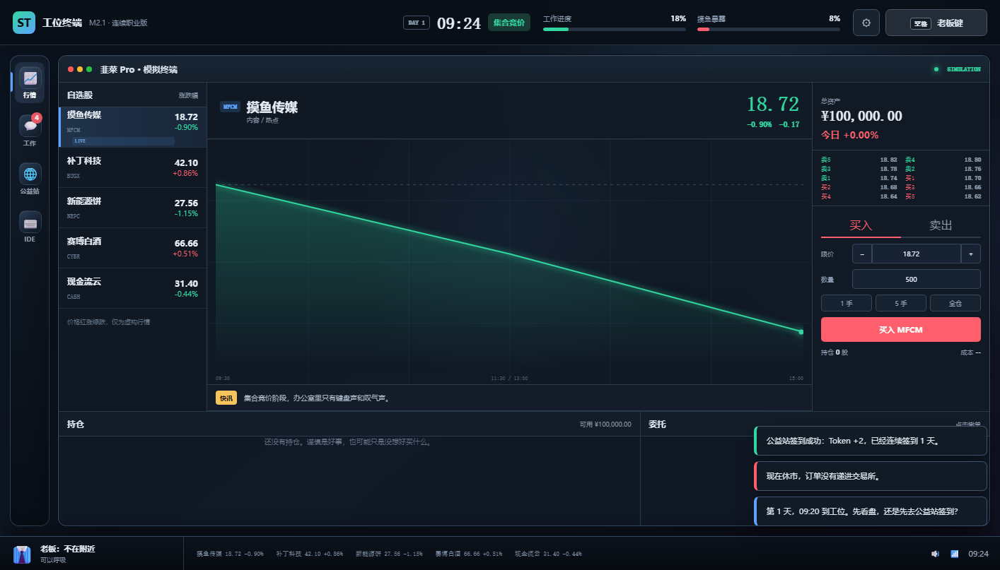

# 今天也想回本

> 上班、炒股、抢 Token——三件事里至少做好一件。



《今天也想回本》是一款发生在工位电脑里的桌面炒股模拟小游戏。

[下载 Android APK](https://github.com/xyl9q/today-i-want-to-break-even/releases/latest)

灵感来自身边同事的日常：早上到工位先打开股票，午休醒来再看一眼，下午收盘前继续纠结要不要把短线做成长线。于是我把行情、老板巡查、工作群消息和公益站签到揉在一起，做成了一场从 09:20 持续到 15:00 的工位生存挑战。

## 玩法

- 在五只虚构股票间切换，观察分时图与新闻，进行限价买卖和撤单。
- 处理工作消息以降低摸鱼暴露度；老板靠近时按空格切换到 IDE。
- 前往虚构公益站连续签到，在限时开放时完成颜色校验抢 Token。
- 用 Token 兑换市场雷达、咖啡续命和光速撤单。
- 收盘后自动保存现金、持仓、成本、股价、Token 与签到天数，继续下一天。

事件池包含皮衣发布会、CUDA 护城河、AI 抢显卡和“财报超预期还不够”等近期科技圈梗。每日会轮换不同事件组合。

## 操作

- 鼠标：切换应用、选择股票、下单、处理任务和抢 Token。
- `空格`：老板键，立即切换到 IDE。
- 右上角设置：调整时间速度、提示音、震动、自动存档或清除存档。

## 本地运行

需要 Node.js 22.6 或更高版本。

```bash
npm test
npm run build
npm run serve
```

然后访问 `http://127.0.0.1:4180`。

Android 用户可以在 [Releases](https://github.com/xyl9q/today-i-want-to-break-even/releases) 下载离线 APK。安装包未上架应用商店，首次安装可能需要允许浏览器或文件管理器“安装未知应用”。

## 技术说明

- TypeScript 状态机与原生 HTML/CSS/Canvas
- 无框架、无运行时依赖
- 使用 `localStorage` 保存连续职业进度
- 13 项核心规则与存档测试

## 声明

游戏中的股票、公司、人物和公益站均为虚构，不连接任何真实券商或公益站，不发放真实 Token，也不构成投资建议。
